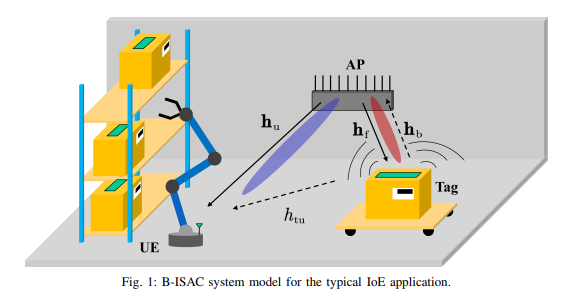
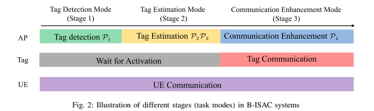
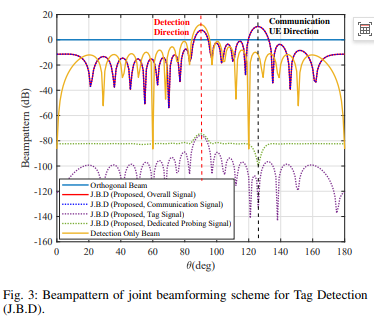
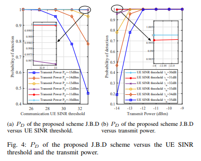
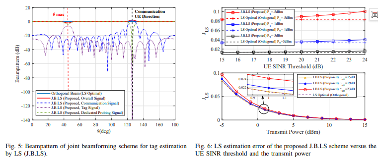
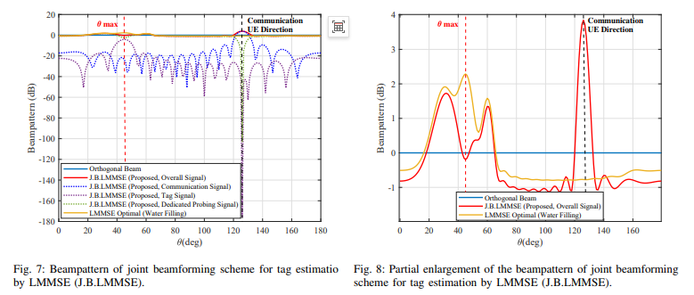
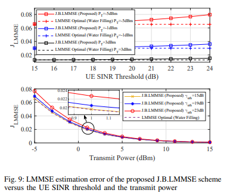
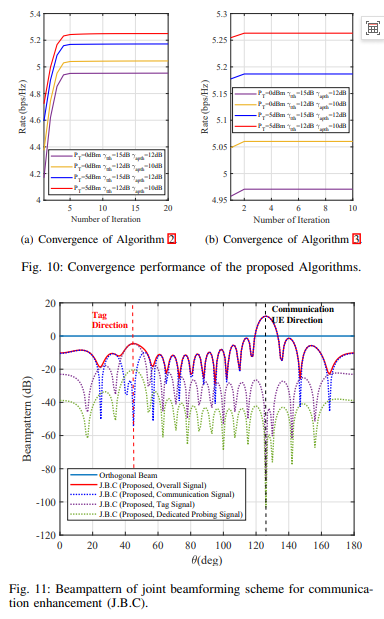
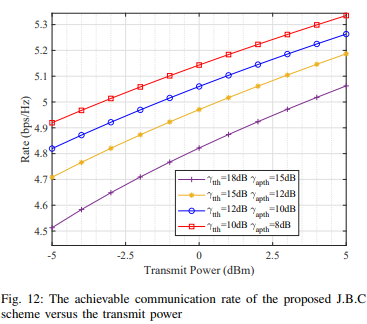

# [ISAC]Let the passive tag "speak": A deep interpretation of the integrated system with transduction enabled by backscattering [with MATLAB code]

The Integrated Sensing and Communication (ISAC) attempts to integrate communication and perception into the same hardware and frequency spectrum, being one of the core enabling technologies for 6G.
However, it has a fundamental shortcoming: most objects of perception are "silent bystanders," neither making a sound nor responding, leaving the system passively "watching."
Is there a way to make the target itself speak without consuming much energy?
Backscatter Communication (BackCom) precisely fills this gap: an inactive radio frequency tag transmits information through modulation of the reflected signal, with extremely low cost and near-zero power consumption.
So, the question arises—what happens if we attach such tags to traditional perception targets?
A research team from Tsinghua University Shenzhen Graduate School in collaboration with Pengcheng Laboratory proposed a system architecture named B-ISAC (Backscatter ISAC), allowing the same inactive tag to serve both as a "perception target" and a "communication node," achieving two birds with one stone.
Some of the related work has been published in IEEE GLOBECOM 2024.
The scenario of B-ISAC is straightforward: a multi-antenna access point (AP), a single-antenna user (UE), and a single-antenna inactive tag.
AP needs to provide downlink communication for UE and "perceive" and communicate with tags;
The tags demodulate the downlink information from the AP signal, while modulating their uplink information onto the amplitude of the reflected signal—a dual-directional communication through a single illumination.
In traditional ISACs, reflection echoes were considered interference, but here they have become useful information carriers.
Of course, this comes at a cost: when the reflected signal reaches the UE, it becomes an additional interference item on the user side, and the system must include this "crosstalk" in the modeling of SINR.
The composition of the transmitted signal is also quite sophisticated.
In addition to the conventional user data stream and tag data stream, the system also superimposes a dedicated probing stream.
These probing streams do not carry any information, their sole purpose is to fill the free degree of freedom of the transmitting waveform to antenna number, striving for maximum space for perception.
In simulation, the number of antennas is set to 16, the symbol length is 2048, and the noise power is uniformly set to -40 dBm, closely matching the scale of actual network conditions.
As a result, there emerge three intertwined SIR (Signal-to-Interference-plus-Noise ratio) values within the system: the received SINR at the tag determines whether the tag can be activated;
The reflected SINR at the AP determines the quality of perception;
UE SINR at the UE determines user quality of service.
The conflict arises from the fact that all three share the same transmit power, which becomes the core thread of the entire design.
The research team divides the task into three consecutive modes corresponding to three different joint beamforming designs.
The first stage: Label detection.
At this point, the system does not know whether there are labels in the environment.
The AP performs a spatial scan in the angle domain using the Neyman-Pearson criterion for binary hypothesis testing, aiming to maximize the detection probability.
Since the detection probability is a monotonically increasing function of the backscatter SINR (complementary error function relationship), the problem is equivalently transformed into maximizing the backscatter SINR on an angle grid while satisfying the UE SINR constraint and power budget.
This is a typical non-convex problem, and researchers use semidefinite relaxation (SDR) technique to relax it into a convex problem that can be globally solved, and prove the rank-one recovery property of the optimal solution—relaxation does not lose any performance, which is not common in similar problems.
The second stage: Label estimation.
After confirming the presence of labels, the next step is to estimate its location and channel.
The problem is divided into two scenarios:
1. Without prior information, the LS (Least Squares) estimation is used.
2. With prior knowledge of the channel, the LMMSE (Linear Minimum Mean Square Error) estimation is employed.

Interestingly, the optimal waveforms for both are quite different: under pure energy constraint, the LS optimal waveform is a directional orthogonal waveform—when there is no prior information, spreading energy evenly across the entire space is the optimal solution;
However, with prior knowledge, the LMMSE optimal waveform degrades to the classic "watering" solution.
The joint beamforming task is to ensure that the overall waveform approaches these theoretically optimal solutions under UE communication constraints.
The third stage: communication enhancement.
After the dust settles on detection and estimation, the system enters a "rate-squeeze" mode: ensuring that the label is activated (label SINR) and perceptible (AP SINR), maximizing the UE's reachable rate.
This problem is significantly more challenging than the previous two stages—the objective function is a logarithmic term of the fractional SINR, and the constraints are non-convex.
Researchers use quadratic transformation to introduce an auxiliary variable, converting the objective function into a polynomial form that is easier to handle, and then iteratively solve using inner iteration with SCA (Successive Convex Approximation) + outer alternating optimization in a dual-loop structure.
In the simulation results, three noteworthy signal values from the experiment are worth noting for those involved in system design.
Firstly, the beamforming directional pattern will "split."
During detection mode, the beam simultaneously forms a high-gain dual main lobes in both the detection direction (90°) and the UE direction (126°), at the cost of power mainly flowing towards the communication signal, with the label and detection signals being suppressed to very low levels—because the transmitted signal is completely known to the AP, the communication signal itself can assist in detection.
This is both a compromise and a wisdom: sacrificing a bit of detection energy for undisturbed communication.
In the estimation phase, however, the LS scheme carves deep grooves for the label and detection signals in the UE direction, while ensuring that the overall waveform aligns as closely as possible with the full-direction orthogonal solution, thereby keeping the estimation error close to its theoretical optimal.
Secondly, LMMSE deserves prior knowledge.
On the curve of "estimation error—UE SINR threshold," the LMMSE scheme surpasses the LS baseline across the entire range;
As the transmitting power increases, both approaches approach their respective theoretical optimals (water-filling/orthogonal).
The finer details are hidden within the beam diagram: The LMMSE beams have made meticulous energy control in the direction of the strongest interference, 45°. This not only reduces the interference with communication but also closely aligns with the water injection process, where local amplification can even reveal "small bumps" left by prior information.
Thirdly, convergence is not slow.
After about 10 iterations of the inner SCA, the rate change is negligible, while the outer alternating algorithm converges after just 5 iterations.
For engineering implementation, this level of convergence means that the iteration overhead is entirely acceptable.
As for the most concern of everyone, the trade-off between communication and perception, four sets of curves point to the same conclusion: the detection probability decreases as the UE's communication threshold increases and rises as the transmission power increases;
The estimation error of LS/LMMSE increases with the increase in communication threshold;
During the communication enhancement phase, the stricter constraints on the SINR of tags/APs lead to lower UE reachable rates.
Perception and communication compete for resources, and the number of antennas, transmission power, noise floor, and channel conditions must be balanced according to needs, without any free lunch.
The value of B-ISAC lies in placing the trade-off between "perception—communication" in a more realistic scenario: the target is no longer silent but low-power, communicable.
The detection, estimation, and enhancement stages are progressively intertwined, corresponding to the complete link from "Has Tags" to "Where are the Tags" to "How to Fully Utilize Rates" in real deployment. This way of thinking about tasks has direct applicability for engineering implementation.
Of course, there are limits to the work: Currently, only a preliminary scenario with a single UE and a single label is explored, assuming no self-interference between the transmit and receive arrays.
In scenarios involving multiple users and multiple tags, multi-user and multi-interference inevitably upgrade both performance modeling and algorithm design;
Extending the analysis based on channel statistical priors to time-varying channels is also worth delving into—these are precisely the directions that warrant anticipation in the future.
From system architecture to optimization algorithms, this work outlines a comprehensive path for integrating backscatter communication with integrated sensory capabilities.
As passive tags begin to "reflect and speak simultaneously," the last mile of smart connectivity might be encapsulated within these tiny scattered signals.
Reference: Z. Zhao et al., "B-ISAC: Backscatter Integrated Sensing and Communication for IoE Applications," arXiv:2407.19235;
See related work in IEEE GLOBECOM 2024.

## Images

<!-- PAYMENT_BLOCK -->

## Get this dataset

- Payment link (Stripe): [Buy now](https://buy.stripe.com/3cs8yP7sY87d0vu9AB)
- Payment QR code: 

<!-- /PAYMENT_BLOCK -->
